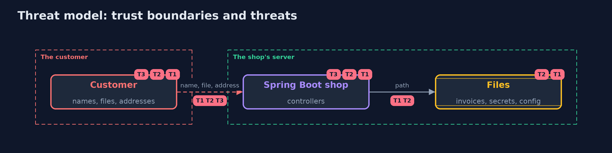

# Threat Model — Path Traversal and File Upload with Spring Boot

A threat model answers four questions: what are we protecting, who or what could harm it, how, and what do we do about it. This one covers this project's own demo system, not a production deployment. Domain: an online store's invoices and product photos.

## Scope

A Spring Boot shop that reads invoices by name, accepts uploaded photos and redirects to a return address. It covers the name, the path, the uploaded bytes and the redirect target. It does not cover the content of images or the web server's own configuration.

## What we protect (assets)

- Secrets and configuration files on the server.
- Other customers' invoices and payroll files.
- The customers' trust in links on the shop's pages.

## Who and what acts on the system

- A customer who controls a name, a file and an address.
- A staff member whose upload form is used by an attacker.

## Trust boundaries

A trust boundary is a line that data or a request crosses between parts that trust each other differently. Threats cluster where those lines are.

- The request to the controller: every name, byte and address is untrusted.
- The controller to the file system: the shop's rights are wider than the customer's.

Each dashed box is a trust boundary. A rose tag such as T1 shows where the threat of that number, in the table below, applies.

## Threats, using STRIDE

STRIDE is a checklist of six kinds of threat: **Spoofing** (S), **Tampering** (T), **Repudiation** (R), **Information disclosure** (I), **Denial of service** (D), **Elevation of privilege** (E).

| Id | Kind | Threat | Where it shows up | Control in this project | What is left |
| --- | --- | --- | --- | --- | --- |
| T1 | Information disclosure | A name with dot-dot, a sibling folder or a link reads a file outside the invoice folder | `NaiveDownloads`, `PrefixDownloads` | A name pattern, an element-by-element path check and a real-path check | A file inside the folder that is not meant for this customer |
| T2 | Tampering | An upload keeps the customer's name or type and overwrites a file or serves a script | `NaiveUploads` | A server-made name, a type from the bytes, a download with nosniff, and size limits | A harmful file that is a valid image |
| T3 | Spoofing | A return address sends the customer to an attacker's site | `ReturnLink.naive` | Only a path on this site, and an exact host match where an absolute address is needed | A path on this site that itself redirects |

## Assumptions

- The server's account can read files outside the invoice folder.
- Symbolic links can be created in the folder.

## Out of scope

- Malicious content inside a valid image.
- Denial of service from many uploads.

## How the tests check this

- `FilesSpringTest` starts real servers over a temporary layout and checks the naive, prefix and safe downloads, Spring's static handler, the naive and safe uploads, the size limits, the redirects and the host check.
- `DemoRunsTest` compares the whole demo with the golden output.

## Where this model goes next

The next module, secure-configuration, moves from what customers send to what the shop's own settings expose.
