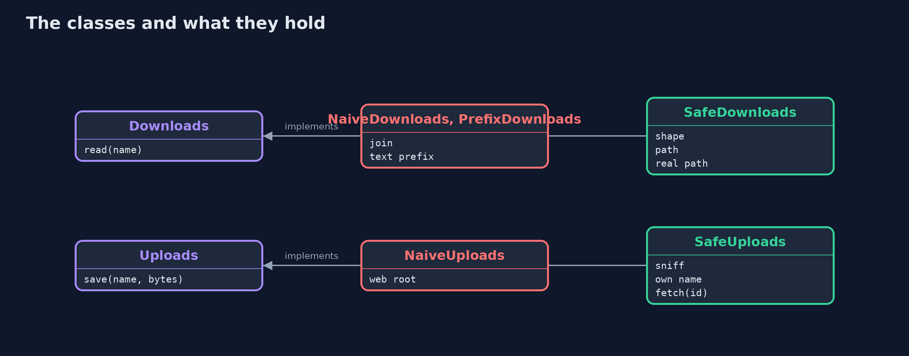
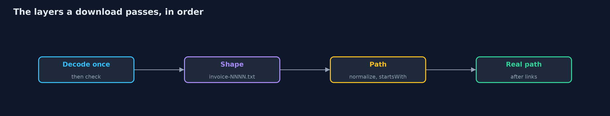

# Path Traversal, File Upload and Open Redirects

```
src/main/java/com/jk/explore/security/files/
├── Downloads.java        "Download invoice {name}": returns the text of the file
├── FilesDemo.java        Runs the invoice download, photo upload and "return to" story in five numbered acts and prints exact, repeatable results
├── Layout.java           The folders of the store's server, made in a temporary directory so the demo and the tests touch nothing else: <pre> invoices/ what customers may download invoices-private/ a sibling whose name starts the same way secrets/ the database settings config/ the application's settings webroot/ files the web server hands out as they are uploads-private/ where the fixed version keeps uploads, outside the web root </pre>
├── NaiveDownloads.java   The first version: the file is whatever the base folder plus the name says, {@code ..} included
├── NaiveUploads.java     The first version: the file is saved in the web root under the name the customer gave, whatever it contains
├── PrefixDownloads.java  The second version: it does check the resolved path, but compares <em>text</em>, so a sibling folder with the same beginning passes
├── Refused.java          The request was refused
├── ReturnLink.java       The "return to" address after sign-in or upload: where the customer is sent next
├── SafeDownloads.java    The fixed version, in layers: the name must look like an invoice name, the path is resolved and compared as a <em>path</em> (element by element), and the real file, after symbolic links are followed, must still be inside the real folder
├── SafeUploads.java      The fixed version: size limit, the type decided from the bytes and not from the name, a name the <em>server</em> makes, storage outside the web root, and downloads that name the type, force a download and forbid the browser to guess
├── Served.java           What the web server sends back for a file: the type it claims, whether the browser must save instead of show, and the body
├── Sniffer.java          Decides what a file is from its first bytes, the only part the customer cannot rename
├── Uploads.java          "Upload a product photo": the customer sends a file name and bytes
└── WebRoot.java          The web server's static files: whatever is in the folder is sent as it is, with a type chosen by the file name's extension
```

**A name or a link that a customer sends is not a file or a place you can trust: resolve and compare paths as paths, let the server name uploads and decide their type from the bytes, keep them outside the web root, and send customers only to paths on your own site.**

Three features take a name or a link from a customer: **download invoice {name}**, **upload a product photo**, and **return to {address} after sign-in**. A file name can contain `..` and walk
out of its folder (**path traversal**). An uploaded file keeps whatever name and contents the customer chose, so it can replace a settings file or be served as a page with a script in it
(**unrestricted file upload**). A "return to" address can send a signed-in customer to another site that looks like yours (**open redirect**).

The defences, in the order this project shows them:
- **Check the name's shape,** then **resolve the path and compare it as a path** (element by element, not as text), and follow symbolic links before trusting the result.
- **Decode once,** at one place, and check after decoding.
- **Uploads:** a size limit, the type decided from the first bytes, a name the server makes, storage outside the web root, and downloads that say the type, force a download and forbid sniffing.
- **Redirects:** only a path on your own site; `//host`, `/\host` and a scheme are other sites; an exact host match if an absolute address must be allowed.

**Maps to:** OWASP Top 10 (2025) A01 Broken Access Control · CWE-22 · CWE-434 · CWE-601 · OWASP ASVS 5.0, the file handling and validation chapters.

## The idea in everyday terms

Think of a clerk who fetches a file from the "invoices" drawer when a customer reads out a name. If the customer may say "go up one drawer, and open the one marked secrets", the clerk walks out of the
drawer. And a clerk who files whatever the customer hands over, under any name, will one day file a forged form over the real one.

## The scenario

An online store lets customers download their invoices, upload product photos and return to the page they came from. The demo builds a small server file tree in a temporary folder, with
invoices, a sibling folder with a similar name, secrets, settings and a web root, and runs every attack against it.

## Run

```bash
./gradlew run
```

The demo tells the story in 6 acts, each printing exact numbers that the tests check:

| Act | What it shows |
| --- | --- |
| 1. Downloading an invoice | An honest name reads invoice 1001. |
| 2. A name with .. leaves the folder | ../secrets/db.txt returns the database settings and ../config/app.properties returns the application settings. |
| 3. A text check on the path is not a path check | Comparing the resolved path as text refuses ../secrets but accepts ../invoices-private, whose name starts the same way. |
| 4. Names, paths and links, all checked | The name must look like an invoice name, the path is compared element by element, and links are followed before being trusted; encoded dots are decoded once and then refused. |
| 5. Uploads | The naive upload overwrites the settings and serves a script as a page; the fixed one decides from the bytes, names the file itself, stores it outside the web root and serves it as a download. |
| 6. Where to send the customer next | The naive link goes anywhere, including //evil.example and javascript:; the fixed one sends only paths on this site and everything else to /account; absolute hosts are matched exactly. |

## Test

```bash
./gradlew test
```

11 tests in `DemoRunsTest`, `FilesTest`. The temporary folder's name is random and never printed, so the demo prints the same text on every run.

## What the simulation got right, and what it left out

The file system is real: the demo makes a temporary folder with the layout above, including a symbolic link, and deletes it afterwards. The folder's name is never printed.
The web server is a small class that serves files as they are, which is what a naive static server does.

## Technologies and versions

Every version below is pinned in the project's build files and was the latest stable release when the project was built.

| Technology | Version | Used for |
| --- | --- | --- |
| Java | 25 | the language and runtime; a Gradle toolchain finds or downloads the JDK |
| Gradle | 9.8.1 (wrapper) | build and run; nothing to install, the wrapper downloads it |
| org.junit.jupiter:junit-jupiter | 6.1.3, set by junit-bom | JUnit 5: the tests (tests only) |
| org.junit.platform:junit-platform-launcher | 6.1.3, set by junit-bom | JUnit platform launcher, which Gradle needs to run the tests (tests only) |

## Learning Material

| Document | What it is for |
| --- | --- |
| [Problem statement](docs/problem-statement.md) | the situation and what the project must show |
| [Prerequisites](docs/prerequisites.md) | what you need to know first |
| [Path Traversal, File Upload and Open Redirects, explained](docs/path-traversal-and-file-upload-explained.md) | the acts in prose |
| [Session guide](docs/session.md) | a one-hour lesson with exercises |
| [Animated walkthrough](docs/animation.html) | the acts step by step |
| [Threat model](docs/threat-model.md) | what is protected, who could harm it, and how, using STRIDE |
| [Spec](docs/spec.md) | what this project must be true of |
| [Expected output](docs/expected-output.txt) | the golden demo output every test and every port checks against |

### The idea in one picture

The name becomes a path, the upload becomes a file, the link becomes a redirect.


### Where each piece sits

Each feature has a naive version and a fixed one behind the same interface.



### How the data moves

Each layer catches something the one before it cannot.



### Who calls whom, in order


## What it costs

- **Strict names are less flexible.** `invoice-NNNN.txt` is easy to check, and a system that must accept arbitrary file names needs ids that the server maps to files.
- **Content checks are a floor, not a ceiling.** The first bytes show a PNG, but an image can still hold exploits for its viewer; process images with a hardened library, and re-encode if you can.
- **Storage outside the web root needs a download handler,** which has to set the type and the headers itself.
- **Links and case-insensitive file systems** add cases; test on the platform you deploy to.
- **Allow-listing redirect hosts needs upkeep,** and any redirect that is only for convenience is better replaced by a fixed page.

## When this is too much

If the invoice can be fetched by an id from a database, there is no path to check. If the uploaded photo is re-encoded and stored under a generated name, there is no customer name or content to trust.
Do not try to strip `..` from names: `....//` becomes `../` after one pass. Reject, don't repair.

## Where you have already met this

- `../../etc/passwd` in every list of attack strings.
- `new File(base, userInput)` and `Paths.get(base, name)` in older code.
- A `next` or `returnUrl` parameter on every login page.
- Findings titled "Path Traversal" (CWE-22), "Unrestricted Upload" (CWE-434) and "Open Redirect" (CWE-601).

## Where this sits

This project is in [web-security](..) and follows [insecure-deserialization](../insecure-deserialization): another thing a customer carries to the server.
Its upload checks build on [input-validation](../../secure-coding/input-validation).
