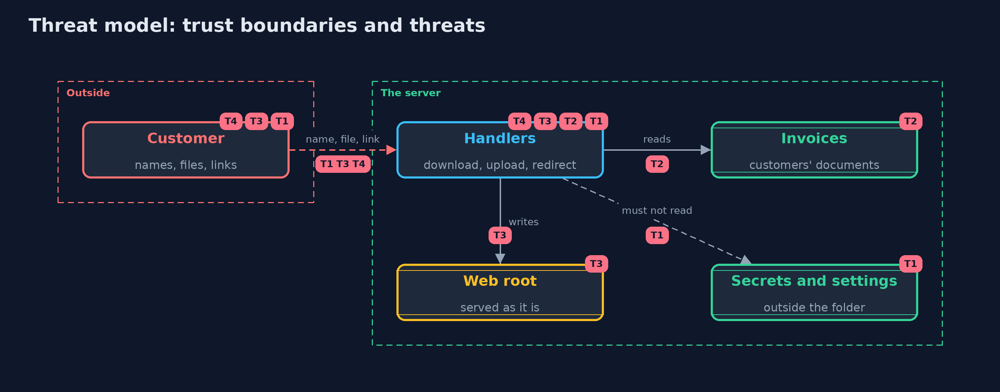

# Threat Model — Path Traversal, File Upload and Open Redirects

A threat model answers four questions: what are we protecting, who or what could harm it, how, and what do we do about it. This one covers this project's own demo system, not a production deployment. Domain: an online store.

## Scope

An online store's invoice download, photo upload and return-to redirect, and the folders of the server. It covers names, file contents and addresses sent by customers.
It does not cover malware in uploaded images, the web server's own configuration, or access to the invoices themselves (who may read which invoice).

## What we protect (assets)

- Secrets and settings on the server.
- Other customers' invoices and documents.
- The store's pages and the trust customers place in its address.

## Who and what acts on the system

- A customer downloading and uploading.
- An attacker who sends names, files and links, or who crafts a link for another customer to click.

## Trust boundaries

A trust boundary is a line that data or a request crosses between parts that trust each other differently. Threats cluster where those lines are.

- Customer to handler: all names, bytes and addresses are untrusted.
- Handler to file system: a path crosses it, and the file system follows `..` and links.

Each dashed box is a trust boundary. A rose tag such as T1 shows where the threat of that number, in the table below, applies.

## Threats, using STRIDE

STRIDE is a checklist of six kinds of threat: **Spoofing** (S), **Tampering** (T), **Repudiation** (R), **Information disclosure** (I), **Denial of service** (D), **Elevation of privilege** (E).

| Id | Kind | Threat | Where it shows up | Control in this project | What is left |
| --- | --- | --- | --- | --- | --- |
| T1 | Information disclosure | A name with .. or an encoded form reads files outside the folder | `NaiveDownloads`, `PrefixDownloads` | Name shape, normalized path compared as a path, real path after links | Anything that can write a link into the folder |
| T2 | Information disclosure | A sibling folder with a similar name passes a text check | `PrefixDownloads` | `Path.startsWith` compares whole elements | None known in the model |
| T3 | Tampering | An upload replaces a settings file or is served as a script on our own site | `NaiveUploads`, `WebRoot` | Server-made name, type from the bytes, storage outside the web root, download headers | An image that exploits the program that opens it |
| T4 | Spoofing | A return link sends a signed-in customer to a look-alike site | `ReturnLink.naive` | Only paths on this site, exact host matching when absolute | Pages on our own site that themselves redirect to a parameter |

## Assumptions

- The server process can read more than the invoices folder (that is why traversal matters).
- The static web server serves files as they are, with a type from the extension.

## Out of scope

- Which customer may read which invoice: the broken-access-control project.
- Antivirus scanning and image-parser exploits.

## How the tests check this

- `FilesTest` checks every download version against names, encodings, siblings and links, both upload versions, the sniffer and the return-link rules.
- `DemoRunsTest` compares the whole demo with the golden output.

## Where this model goes next

The next module, secure-configuration, moves from what customers send to how the server itself is set up.
