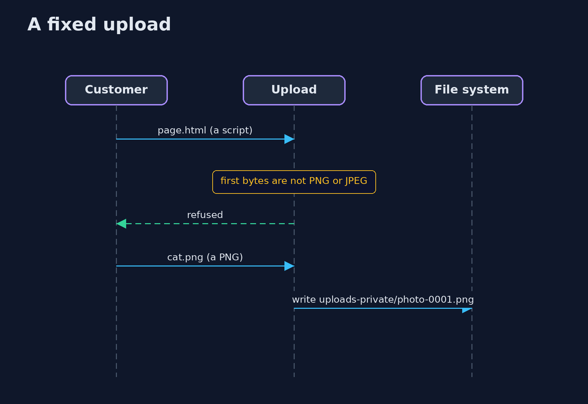
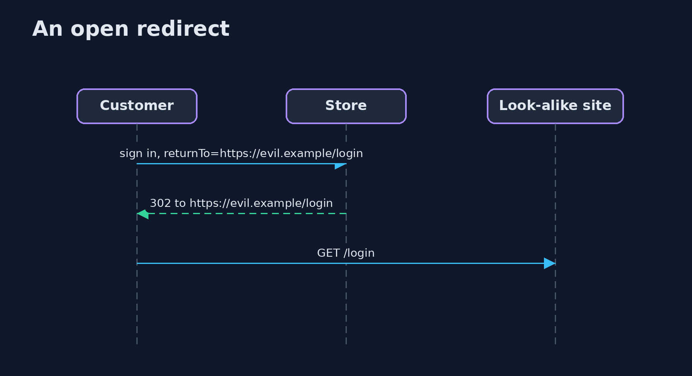

# Path Traversal, File Upload and Open Redirects — UML Sequence Diagrams

## 1. A fixed upload

## 2. An open redirect

The look-alike site shows a sign-in page to a customer who has just come from the real one.

