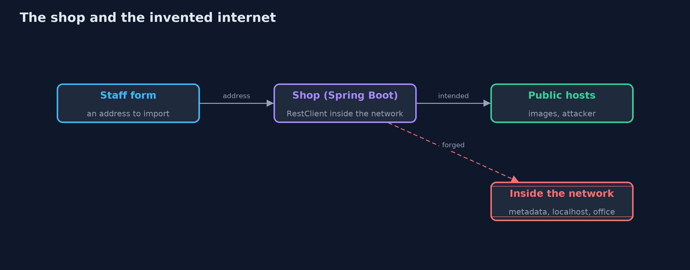
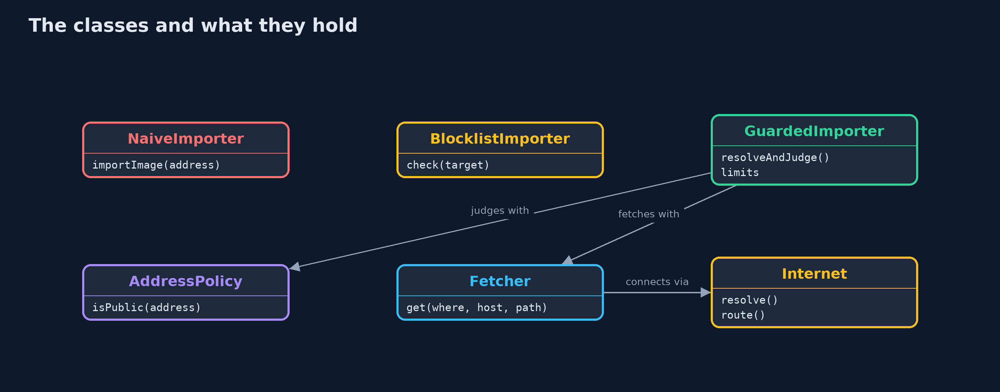
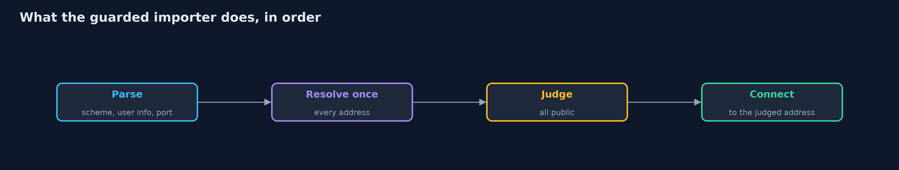

# Server-Side Request Forgery with Spring Boot

```
src/main/java/com/jk/explore/security/ssrfspring/
├── AddressPolicy.java      Which addresses a server may fetch from for a customer: public ones only
├── BlocklistImporter.java  The second version: refuse a short list of names
├── Dns.java                Name to addresses
├── Fetcher.java            One request over Spring's {@link RestClient}, to an address that has already been chosen, with the original host in the Host header
├── GuardedImporter.java    The fixed version
├── ImportController.java   "Import a product image from a web address", as a staff member's form posts it
├── ImportRefused.java      The importer refused an address, with the reason it gives back to the caller
├── Importer.java           "Import a product image from a web address": fetch the address and return what it holds
├── ImporterConfig.java     Which importer the shop runs is chosen by profile, so one controller serves all four versions
├── Internet.java           A small invented internet on the loopback address: a public image host, an attacker's host, the cloud metadata address, the shop's own configuration service on localhost and an office admin page
├── NaiveImporter.java      The first version: fetch whatever address the customer gives, and follow whatever redirect comes back
├── Router.java             Where a connection to an address really goes
├── ShopApp.java            
├── SsrfSpringDemo.java     Runs the product image import story in five numbered acts against real Spring Boot servers and a small invented internet on loopback
├── Target.java             An address taken apart by hand, the same way for every importer
└── TwoStepImporter.java    The mistake that looks like a fix: resolve the name and judge it, then hand the same name to the client, which resolves it again
```

**When a Spring Boot shop fetches an image from a customer's address, the server's network position becomes the attacker's; a name blocklist is read one way by the check and another by the network, so the fix is to resolve the name once, judge every resulting address, connect to the address that was judged, revalidate each redirect, and limit the type, size and time of the answer.**

The plain [server-side-request-forgery](../server-side-request-forgery) project simulates the network. This one uses the real thing: **Spring Boot 4.1** with Spring's **`RestClient`** fetching from real HTTP servers on the loopback address. A small *invented internet* maps public, metadata and intranet addresses onto those servers, so the attacks work for real without leaving the machine.

What it shows:
- **A staff form "import an image from a web address"** lets the server fetch the cloud metadata address, localhost and the office admin page, because the server sits inside the network that the attacker cannot reach.
- **A blocklist of names is read as text,** while the network layer reads an address. A decimal spelling, `127.1`, a mapped IPv6 address, a name that points inside and a redirect from an outside address all walk round it.
- **The fix judges the resolved address.** The name is resolved once, every address it resolves to is checked, and the connection goes to the address that was checked, with the original host in the `Host` header. Each redirect is judged again, user info and odd ports are refused, and the answer must be a small image that arrives in time.
- **Check-then-connect is not enough.** A name server that answers a public address first and a private one next defeats a client that resolves the name twice.

**Maps to:** OWASP Top 10 (2025) A01 Broken Access Control, which now includes server-side request forgery · CWE-918 · OWASP ASVS 5.0 V5 (File Handling) · OWASP SSRF Prevention Cheat Sheet.

## The idea in everyday terms

A receptionist who will phone any number a visitor writes on a slip. The visitor cannot enter the back office, but the receptionist's phone can reach every extension. If the receptionist checks the slip for the word "payroll" and the visitor writes the extension number instead, the call goes through.

## The scenario

An online store lets staff import a product image from a web address. The demo starts the real shop five times, with a different importer each time, and posts addresses to it. The addresses lead into a small invented internet of local servers.

## Run

```bash
./gradlew run
```

The demo tells the story in 5 acts, each printing exact numbers that the tests check:

| Act | What it shows |
| --- | --- |
| 1. Importing an image from a web address | An honest address fetches the image. |
| 2. The server fetches whatever it is told | The metadata address, localhost and the office admin page all answer the importer with their secrets. |
| 3. A blocklist of names is easy to walk around | The listed name is refused; a decimal spelling, 127.1, a mapped IPv6 address, a name that points inside and a redirect all get through. |
| 4. Check the address the connection really uses | The importer resolves the name once, judges every address, connects to the judged address and judges each redirect again; every disguise is refused and the honest address still works. |
| 5. Limits, and why checking and then connecting is not enough | Odd ports, pages that are not images, large answers and slow answers are refused; a client that checks and then connects by name is beaten by a rebinding name server. |

## Test

```bash
./gradlew test
```

15 tests in `DemoRunsTest`, `ImporterTest`, `PolicyTest`. Each server answers on its own thread, and the timeouts are generous, so the demo prints the same text on every run.

## What the simulation got right, and what it left out

The shop is a real Spring Boot application, the client is Spring's `RestClient` over the JDK HTTP client, and the answers come from real HTTP servers on loopback. Only the addresses are invented: the demo's name server and router send a connection for an invented address to a local server. Ports are never printed.

## Technologies and versions

Every version below is pinned in the project's build files and was the latest stable release when the project was built.

| Technology | Version | Used for |
| --- | --- | --- |
| Java | 25 | the language and runtime; a Gradle toolchain finds or downloads the JDK |
| Gradle | 9.8.1 (wrapper) | build and run; nothing to install, the wrapper downloads it |
| org.springframework.boot:spring-boot-starter-webmvc | 4.1.1, set by spring-boot-dependencies | library the code uses |
| org.springframework.boot:spring-boot-starter-webmvc-test | 4.1.1, set by spring-boot-dependencies | library the code uses (tests only) |
| org.junit.jupiter:junit-jupiter | 6.1.3, set by junit-bom | JUnit 5: the tests (tests only) |
| org.junit.platform:junit-platform-launcher | 6.1.3, set by junit-bom | JUnit platform launcher, which Gradle needs to run the tests (tests only) |
| videokit | repository tool (`tools/videokit`) | the narrated video and animation: Piper `en_US-amy-medium`, speed 0.8, longer pauses (the amy-slow voice) |

## Learning Material

| Document | What it is for |
| --- | --- |
| [Problem statement](docs/problem-statement.md) | the situation and what the project must show |
| [Prerequisites](docs/prerequisites.md) | what you need to know first |
| [Server-Side Request Forgery with Spring Boot, explained](docs/server-side-request-forgery-with-spring-boot-explained.md) | the acts in prose |
| [Session guide](docs/session.md) | a one-hour lesson with exercises |
| [Animated walkthrough](docs/animation.html) | the acts step by step, narrated |
| [Threat model](docs/threat-model.md) | what is protected, who could harm it, and how, using STRIDE |
| [Spec](docs/spec.md) | what this project must be true of |
| [Expected output](docs/expected-output.txt) | the golden demo output every test and every port checks against |

### The idea in one picture

The shop's server can reach servers that the attacker cannot.



### Where each piece sits

Four importers share the parsing, the resolver and the fetcher; only the checks differ.



### How the data moves

The address is judged after resolution and the connection goes to the judged address.



### Who calls whom, in order


### Video

`video/server-side-request-forgery-with-spring-boot-explained.mp4` (with `.m4a` audio and `.srt` subtitles) is built by `video/build_video.sh`. Rendered media is not committed.

## What it costs

- **Connecting to a chosen address needs the Host header,** and an HTTPS client must keep the name for the certificate check, which a plain address-literal URL does not.
- **Real DNS can change between lookups,** so the lookup and the connection must use the same answer.
- **Redirects need judging again** or are not followed at all, and some honest hosts redirect.
- **Allow-lists of hosts are stronger than address checks** where the shop knows its image hosts, but staff ask for new ones.
- **Egress rules in the network are the second wall,** because code can still be wrong.

## When this is too much

If the shop knows which hosts it imports from, keep an allow-list of hosts and let the network refuse everything else. The address checks in this project are for a feature that must accept any public address.

## Where you have already met this

- `RestClient.get().uri(url)` with a URL from a request parameter.
- A cloud metadata address in an incident report.
- `InetAddress.isSiteLocalAddress()` in a validation helper.
- A webhook or image import form that takes a URL.

## Where this sits

This is the tools version of [server-side-request-forgery](../server-side-request-forgery), in the [web-security](..) module. It follows the same five stories and prints the same lines where the stories match.
