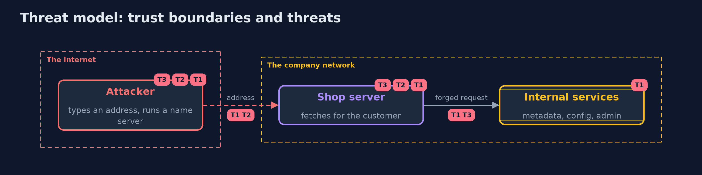

# Threat Model — Server-Side Request Forgery with Spring Boot

A threat model answers four questions: what are we protecting, who or what could harm it, how, and what do we do about it. This one covers this project's own demo system, not a production deployment. Domain: an online store's product image import.

## Scope

A Spring Boot shop feature that fetches an image from an address supplied by staff, running inside a company network. It covers the address, resolution, redirects and the answer. It does not cover the network's own egress rules or the content of an accepted image.

## What we protect (assets)

- Cloud credentials from the metadata service.
- Internal services and their data.
- The shop server's availability.

## Who and what acts on the system

- A staff member, or an attacker who controls what staff paste.
- An attacker who runs a web server and a name server.

## Trust boundaries

A trust boundary is a line that data or a request crosses between parts that trust each other differently. Threats cluster where those lines are.

- The staff form to the importer: the address is untrusted.
- The importer to the network: the server's position is trusted and the address is not.

Each dashed box is a trust boundary. A rose tag such as T1 shows where the threat of that number, in the table below, applies.

## Threats, using STRIDE

STRIDE is a checklist of six kinds of threat: **Spoofing** (S), **Tampering** (T), **Repudiation** (R), **Information disclosure** (I), **Denial of service** (D), **Elevation of privilege** (E).

| Id | Kind | Threat | Where it shows up | Control in this project | What is left |
| --- | --- | --- | --- | --- | --- |
| T1 | Information disclosure | The server fetches an internal address for the attacker and returns what it holds | `NaiveImporter`, `BlocklistImporter` | Judge every resolved address with `AddressPolicy`, connect to the judged address | Internal services that are public by mistake |
| T2 | Tampering | A redirect or a rebinding name server changes the target after the check | `GuardedImporter`, `TwoStepImporter` | Resolve once, connect to the judged address, judge every redirect from the start | A name server that returns a public address that is later reassigned |
| T3 | Denial of service | A huge or slow answer ties up the server | `Fetcher` | A maximum size, a timeout, an image-only content type and two ports | Many slow requests together |

## Assumptions

- Internal services answer without authentication to anything on the network.
- The resolver tells the truth about what it returned.

## Out of scope

- HTTPS and certificate handling.
- Malicious image content.

## How the tests check this

- `PolicyTest` checks which addresses are public however they are spelled, and how an address is taken apart.
- `ImporterTest` runs each importer against the invented internet over real HTTP.
- `DemoRunsTest` compares the whole demo through real Spring Boot servers with the golden output.

## Where this model goes next

The next project, xml-and-template-injection, moves to documents and templates that a server parses for a customer.
