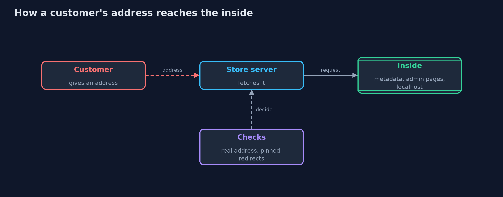
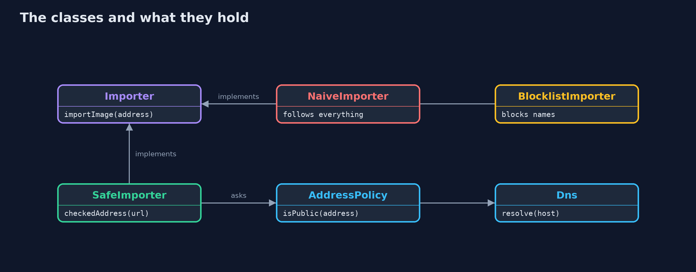
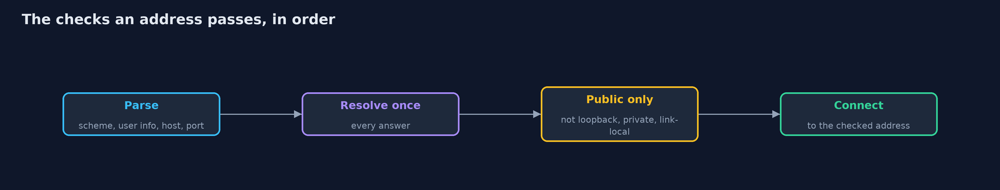
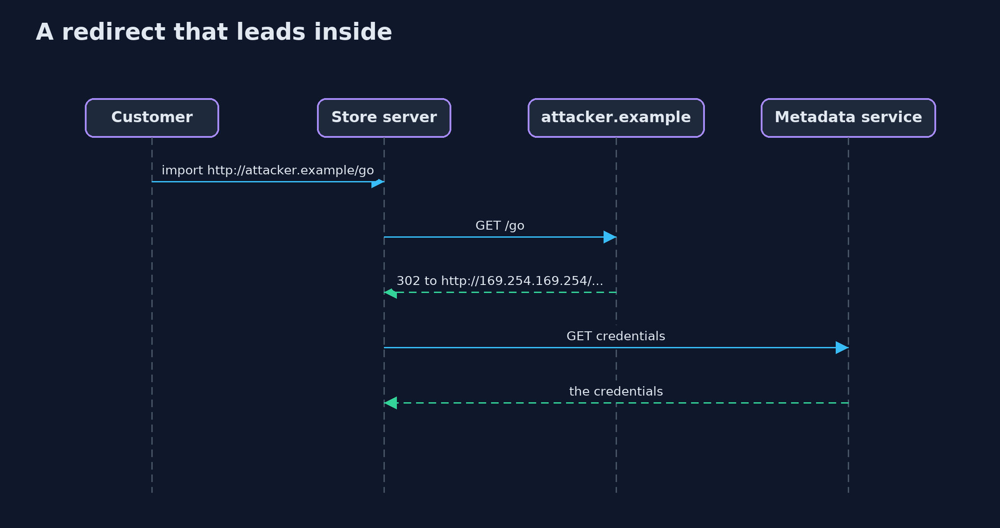

# Server-Side Request Forgery (SSRF) and Its Defences

```
src/main/java/com/jk/explore/security/ssrf/
├── AddressPolicy.java      Decides, from the real address and not from its spelling, whether a server may connect to it
├── BlocklistImporter.java  The second version, a blocklist of host <em>names</em>: it checks the text of the address, not the address the connection really goes to
├── Dns.java                A model of name resolution with fixed answers
├── ImportRefused.java      The import was refused
├── Importer.java           "Import a product image from a web address": the server fetches the address for the customer
├── NaiveImporter.java      The first version: fetch whatever address the customer gives, and follow every redirect
├── Network.java            The world the store's server can reach, as a table from address and path to a response
├── Response.java           What a server answers: a status, a content type, a redirect target for 3xx, and a body
├── SafeImporter.java       The fixed version
├── SsrfDemo.java           Runs the product image import story in four numbered acts and prints exact, repeatable results
├── Unreachable.java        No host with that name, or nothing listening at that address
└── Url.java                A web address taken apart by hand, so each part can be checked: scheme, user info, host, port and path
```

**A feature that makes the server fetch a customer's address lets the customer reach whatever the server can reach, so check the address the connection really uses, connect to the address you checked, and look again at every redirect.**

"Import a product image from a web address" looks harmless: the customer pastes an address and the **server** fetches it. But the server sits inside the
company network, where it can reach things no customer can: the cloud **metadata service**, the server's own admin pages, and the office network. The customer
only has to give an address that points there. That is **server-side request forgery (SSRF)**: the customer forges a request, and the trusted server sends it.

The defences, in the order this project shows them:
- **Check the address, not the text.** Resolve the host name and test the real address: loopback, link-local, private and shared ranges are refused, however the address is spelled (`2852039166`, `127.1`, `::ffff:a9fe:a9fe`).
- **Connect to the address you checked.** If the name is looked up again, an attacker's DNS server can answer differently the second time (**DNS rebinding**).
- **Check every redirect,** and every address a name resolves to.
- **Narrow what is fetched:** web schemes and ports only, no user info, images only, a size limit, and a generic error for the customer.

**Maps to:** OWASP Top 10 (2025) A01 Broken Access Control · CWE-918 · OWASP ASVS 5.0, the validation chapter (SSRF protection).

## The idea in everyday terms

Think of a receptionist who will phone any number a visitor writes on a slip and read back what the other end says. The receptionist's desk phone can reach
the director's private line and the vault, which the visitor's cannot. A blocklist of three numbers is a list of the ones somebody thought of; the fix is to look at where
the call really goes, and to dial only the number that was checked.

## The scenario

An online store lets sellers import a product image from a web address. The demo simulates the network the store's server can reach, with a public image host,
an attacker's host, the cloud metadata address, the server itself and an internal admin page. All secrets are harmless markers, and nothing leaves the process.

## Run

```bash
./gradlew run
```

The demo tells the story in 5 acts, each printing exact numbers that the tests check:

| Act | What it shows |
| --- | --- |
| 1. Importing an image | An honest address imports a cat picture. |
| 2. The server fetches whatever it is told | The same form reads the cloud credentials, the server's own settings and the internal admin page. |
| 3. A blocklist of names is easy to walk around | A blocklist stops the metadata address as written and nothing else: decimal, short, mapped IPv6, a name that points inside, and a redirect all get through. |
| 4. Check the address the connection really uses | Resolving once and testing every address refuses all nine attacks, while honest imports and the attacker's own public image still work. |
| 5. Why checking and then connecting is not enough | An importer that checks the name and then looks it up again is fooled: it checked a public address and fetched the internal admin panel. |

## Test

```bash
./gradlew test
```

12 tests in `DemoRunsTest`, `SsrfTest`. Everything is fixed data, so the demo prints the same text on every run.

## What the simulation got right, and what it left out

The network is a table of addresses, paths and responses, and DNS is a table of names, so every run is the same and nothing is ever sent. Literal addresses are parsed
by the JDK's own rules, the same rules that make `2852039166` and `127.1` valid addresses to a real connection. A rebinding name answers differently the second time.

## Technologies and versions

Every version below is pinned in the project's build files and was the latest stable release when the project was built.

| Technology | Version | Used for |
| --- | --- | --- |
| Java | 25 | the language and runtime; a Gradle toolchain finds or downloads the JDK |
| Gradle | 9.8.1 (wrapper) | build and run; nothing to install, the wrapper downloads it |
| org.junit.jupiter:junit-jupiter | 6.1.3, set by junit-bom | JUnit 5: the tests (tests only) |
| org.junit.platform:junit-platform-launcher | 6.1.3, set by junit-bom | JUnit platform launcher, which Gradle needs to run the tests (tests only) |
| videokit | repository tool (`tools/videokit`) | the narrated video and animation: Piper `en_US-amy-medium`, speed 0.8, longer pauses (the amy-slow voice) |

## Learning Material

| Document | What it is for |
| --- | --- |
| [Problem statement](docs/problem-statement.md) | the situation and what the project must show |
| [Prerequisites](docs/prerequisites.md) | what you need to know first |
| [Server-Side Request Forgery (SSRF) and Its Defences, explained](docs/server-side-request-forgery-explained.md) | the acts in prose |
| [Session guide](docs/session.md) | a one-hour lesson with exercises |
| [Animated walkthrough](docs/animation.html) | the acts step by step, narrated |
| [Threat model](docs/threat-model.md) | what is protected, who could harm it, and how, using STRIDE |
| [Spec](docs/spec.md) | what this project must be true of |
| [Expected output](docs/expected-output.txt) | the golden demo output every test and every port checks against |

### The idea in one picture

The customer never connects to the inside; the server does.



### Where each piece sits

Three importers share one interface; only the safe one uses AddressPolicy.



### How the data moves

Every redirect goes through the same checks again.



### Who calls whom, in order




### Video

`video/server-side-request-forgery-explained.mp4` (with `.m4a` audio and `.srt` subtitles) is built by `video/build_video.sh`. Rendered media is not committed.

## What it costs

- **Allow-lists beat block-lists, and need upkeep.** If images come from a few known hosts, name them. A general URL import cannot, so it must check addresses.
- **Some customers use private addresses on purpose.** A company that hosts images on its intranet is refused, which is the right default.
- **Resolving yourself is more work.** The code must connect to the address it checked, which many HTTP clients do not allow without a custom resolver.
- **Egress rules still matter.** Address checks in code can have gaps; a network rule that stops the fetch service from reaching internal ranges is a second layer.
- **Metadata services need their own hardening,** such as requiring a session token header, so that one forged GET is not enough.

## When this is too much

If the feature can take a file upload instead of an address, take the upload: there is no request to forge. Do not build a clever parser of addresses;
the address after resolution is the only fact that matters.

## Where you have already met this

- Webhook URLs, avatar imports, link previews, PDF renderers and "fetch this feed" features.
- The cloud metadata address 169.254.169.254 in every list of SSRF payloads.
- A breach report that begins with a server that fetched a URL for a user.
- A finding titled "Server-Side Request Forgery" with CWE-918.

## Where this sits

This project is in [web-security](..) and builds on [cross-site-request-forgery](../cross-site-request-forgery), which turned a browser into the forger.
Here the forger is the server.
