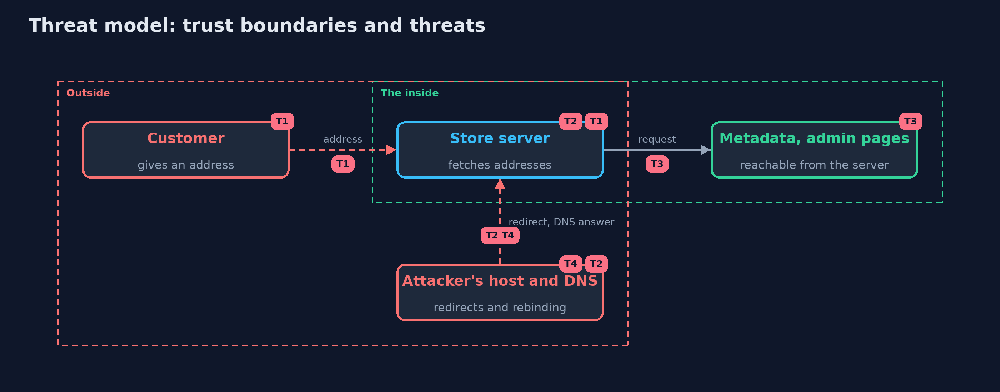

# Threat Model — Server-Side Request Forgery (SSRF) and Its Defences

A threat model answers four questions: what are we protecting, who or what could harm it, how, and what do we do about it. This one covers this project's own demo system, not a production deployment. Domain: an online store.

## Scope

An online store's "import an image from an address" feature, and the network position of the server that runs it. It covers addresses, redirects and DNS answers.
It does not cover the content of the fetched file, or other ways a server can be made to send requests.

## What we protect (assets)

- The server's cloud credentials from the metadata service.
- Internal admin pages and services on the server and the office network.
- The server's availability.

## Who and what acts on the system

- A seller importing an image.
- An attacker who controls an address, a web host and the DNS for a name.

## Trust boundaries

A trust boundary is a line that data or a request crosses between parts that trust each other differently. Threats cluster where those lines are.

- Customer to server: the address is untrusted.
- Server to inside network: the server is trusted there, the customer is not.

Each dashed box is a trust boundary. A rose tag such as T1 shows where the threat of that number, in the table below, applies.

## Threats, using STRIDE

STRIDE is a checklist of six kinds of threat: **Spoofing** (S), **Tampering** (T), **Repudiation** (R), **Information disclosure** (I), **Denial of service** (D), **Elevation of privilege** (E).

| Id | Kind | Threat | Where it shows up | Control in this project | What is left |
| --- | --- | --- | --- | --- | --- |
| T1 | Elevation of privilege | A customer makes the server request an internal address | `NaiveImporter`, `BlocklistImporter` | Resolve, then require a public address (`AddressPolicy`) | A bug in the policy's ranges; add network egress rules |
| T2 | Spoofing | A redirect from an outside host points inside | `SafeImporter` redirect loop | Every redirect goes through the same checks; few hops | None known in the model |
| T3 | Information disclosure | The server's credentials and settings are read through the import | metadata address, localhost | The import never connects there; the metadata service should also need a session token | An application with other server-side fetches that skip the checks |
| T4 | Tampering | DNS gives a public answer for the check and a private one for the connection | `Dns` (rebinding) | Resolve once and connect to the checked address | A client library that resolves again by itself |

## Assumptions

- The server can reach internal addresses (that is why they are worth reaching).
- The importer controls how it connects, so it can connect to a chosen address.

## Out of scope

- Malicious file contents: the path-traversal-and-file-upload project.
- Hardening the metadata service itself.

## How the tests check this

- `SsrfTest` checks each importer against each spelling and route, the address policy, URL parsing, redirects and rebinding.
- `DemoRunsTest` compares the whole demo with the golden output.

## Where this model goes next

The next project, xml-and-template-injection, moves to the files and templates the server processes.
