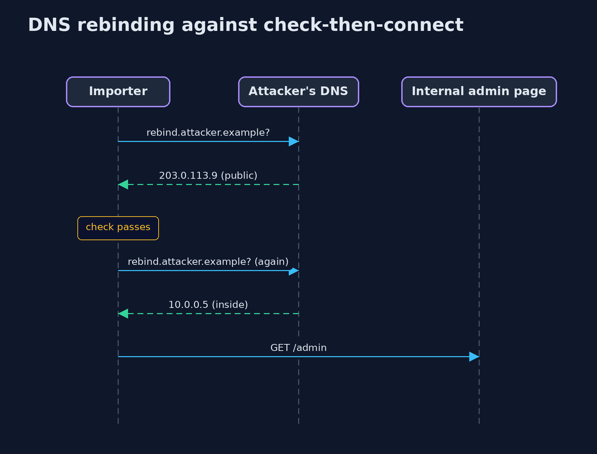
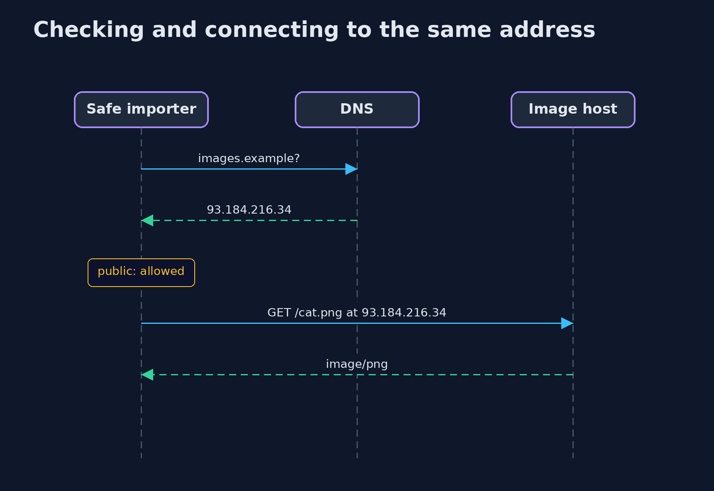

# Server-Side Request Forgery (SSRF) and Its Defences — UML Sequence Diagrams

## 1. DNS rebinding against check-then-connect

The check sees the first answer, the connection uses the second.

## 2. Checking and connecting to the same address

The name is looked up once; the connection goes to that answer.

