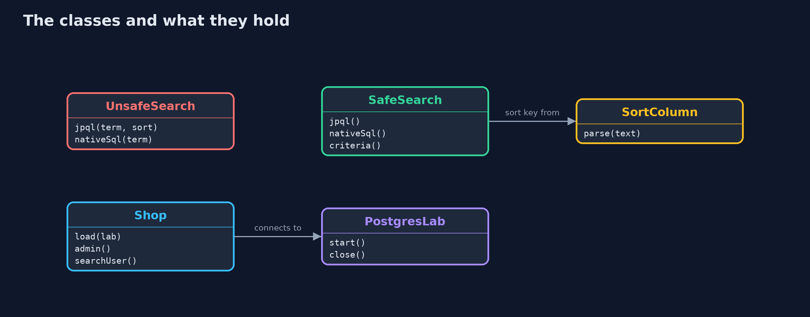
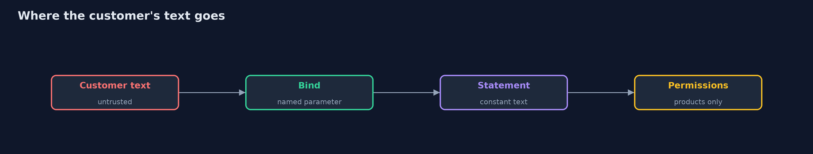

# SQL Injection with Hibernate and PostgreSQL

```
src/main/java/com/jk/explore/security/sqlihibernate/
├── Account.java           A customer account
├── PostgresLab.java       A throwaway PostgreSQL in a Docker container, bound to the loopback address on a free port and removed on close
├── Product.java           A product of the online store
├── SafeSearch.java        The fixed searches: the statement is constant text, the customer's words travel as a parameter, and the sort comes from a list
├── Shop.java              The shop's database and the two database users it connects as
├── SortColumn.java        The only things a customer may sort by
├── SqlHibernateDemo.java  Runs the product search story against a real PostgreSQL in four numbered acts and prints exact, repeatable results
└── UnsafeSearch.java      The first version of the product search, written three ways
```

**An object-relational mapper is not a shield. A JPQL or native query built by pasting text into it is injectable, JPQL can reach every entity and not just the one it names, and the fix is the same as ever: bind parameters, choose sort keys from a list, and connect as a database user who can only do what the page needs.**

The plain [sql-injection](../sql-injection) project injects into a toy database. This one does it where real Java shops are: **Hibernate ORM 7** talking to a real **PostgreSQL 18** that the demo starts in Docker on the loopback address and removes afterwards.

What it shows:
- **Hibernate is not a shield.** `createQuery("... like '%" + term + "%'")` and `createNativeQuery(...)` take a string, and a quote in the customer's text ends the literal and becomes query language.
- **JPQL reaches further than the entity it names.** One concatenated product search can ask a yes or no question about the *account* table (does any password hash start with `pbkdf2$ana`?), so a hole in the product page leaks data from other entities.
- **Native SQL is the whole database.** A `union select` returns every email and password hash.
- **Parameters fix it in all three styles.** Named parameters in JPQL, named parameters in native SQL and the Criteria API keep every payload as plain text. A sort key is the one thing a parameter cannot carry, so it comes from a fixed list.
- **A database user with few rights limits a mistake.** The search page connects as `shop_search`, who may only read the product table: the same injection is refused by PostgreSQL with `permission denied for table users`.

**Maps to:** OWASP Top 10 (2025) A05 Injection · CWE-89 · OWASP ASVS 5.0 V1 (Encoding and Sanitization) · OWASP API Security API8.

## The idea in everyday terms

A librarian who fetches books for you. If the slip you hand over is copied word for word into the librarian's own instruction sheet, a slip that says "this book, and also the staff files" is followed. If the slip is only ever read as a title, it cannot give orders. And a
librarian who has no key to the staff room cannot fetch from it even when fooled.

## The scenario

An online store's product search page. The demo starts PostgreSQL 18 in a container, creates the tables with Hibernate, loads four products (one not yet for sale) and two accounts, and runs the search four ways with attacker text, as two different database users.

## Run

```bash
./gradlew run
```

The demo tells the story in 4 acts, each printing exact numbers that the tests check:

| Act | What it shows |
| --- | --- |
| 1. A search that works | Concatenated JPQL answers an honest search for Kettle with two products. |
| 2. Hibernate does not stop a quote | A quote shows the unlisted product, asks questions about the account table in JPQL, and a native union returns every email and password hash. |
| 3. Parameters keep text as text | Named parameters in JPQL and native SQL and the Criteria API return nothing for every payload; a sort key outside the list falls back to the default. |
| 4. Few rights limit the damage | As shop_search, which may only read products, the same injections are refused by PostgreSQL with permission denied for table users. |

## Test

```bash
./gradlew test
```

11 tests in `DemoRunsTest`, `HibernateInjectionTest`, `SortColumnTest`. Unit tests need nothing; the PostgreSQL tests are tagged `integration` and run with `./gradlew integrationTest`. They start a container and always remove it.

## What the simulation got right, and what it left out

Everything runs for real: Hibernate 7.4 builds and runs the queries and PostgreSQL 18 enforces its permissions. Only the data is small and fixed. The container uses a random loopback port and is removed on exit, so the demo prints the same text on every run.

## Technologies and versions

Every version below is pinned in the project's build files and was the latest stable release when the project was built.

| Technology | Version | Used for |
| --- | --- | --- |
| Java | 25 | the language and runtime; a Gradle toolchain finds or downloads the JDK |
| Gradle | 9.8.1 (wrapper) | build and run; nothing to install, the wrapper downloads it |
| org.hibernate.orm:hibernate-core | set by the build | library the code uses |
| org.postgresql:postgresql | set by the build | library the code uses |
| org.junit.jupiter:junit-jupiter | 6.1.3, set by junit-bom | JUnit 5: the tests (tests only) |
| org.junit.platform:junit-platform-launcher | 6.1.3, set by junit-bom | JUnit platform launcher, which Gradle needs to run the tests (tests only) |
| videokit | repository tool (`tools/videokit`) | the narrated video and animation: Piper `en_US-amy-medium`, speed 0.8, longer pauses (the amy-slow voice) |

## Learning Material

| Document | What it is for |
| --- | --- |
| [Problem statement](docs/problem-statement.md) | the situation and what the project must show |
| [Prerequisites](docs/prerequisites.md) | what you need to know first |
| [SQL Injection with Hibernate and PostgreSQL, explained](docs/sql-injection-with-hibernate-and-postgres-explained.md) | the acts in prose |
| [Session guide](docs/session.md) | a one-hour lesson with exercises |
| [Animated walkthrough](docs/animation.html) | the acts step by step, narrated |
| [Threat model](docs/threat-model.md) | what is protected, who could harm it, and how, using STRIDE |
| [Spec](docs/spec.md) | what this project must be true of |
| [Expected output](docs/expected-output.txt) | the golden demo output every test and every port checks against |

### The idea in one picture

The page connects as shop_search; the schema is created as the admin user.


### Where each piece sits

The unsafe and safe searches share the entities and the factories.



### How the data moves

In the safe version the text never becomes part of the query.



### Who calls whom, in order


### Video

`video/sql-injection-with-hibernate-and-postgres-explained.mp4` (with `.m4a` audio and `.srt` subtitles) is built by `video/build_video.sh`. Rendered media is not committed.

## What it costs

- **Docker is needed to run the demo and the integration tests;** the unit tests do not need it.
- **Parameters cannot carry a table, column or sort direction,** so those come from an enum or an allow-list.
- **A least-privilege database user means more than one connection setup:** schema changes use an admin user, the application another.
- **The Criteria API is verbose,** which is why teams drift back to string-built JPQL.
- **Review is needed for every native query and every string that reaches `createQuery`.**

## When this is too much

Almost all application queries should use derived or annotated repository methods with bound parameters, and never need string building. Reserve native queries for things the mapper cannot express, and parameterise those too.

## Where you have already met this

- `@Query("... where p.name like :term")` in Spring Data repositories.
- `entityManager.createNativeQuery("... " + input)` in code reviews.
- `GRANT SELECT ON ... TO ...` in a database setup script.
- HQL injection write-ups.

## Where this sits

This is the tools version of [sql-injection](../sql-injection), in the [web-security](..) module. It follows the same four acts, so the numbers can be compared one for one.
