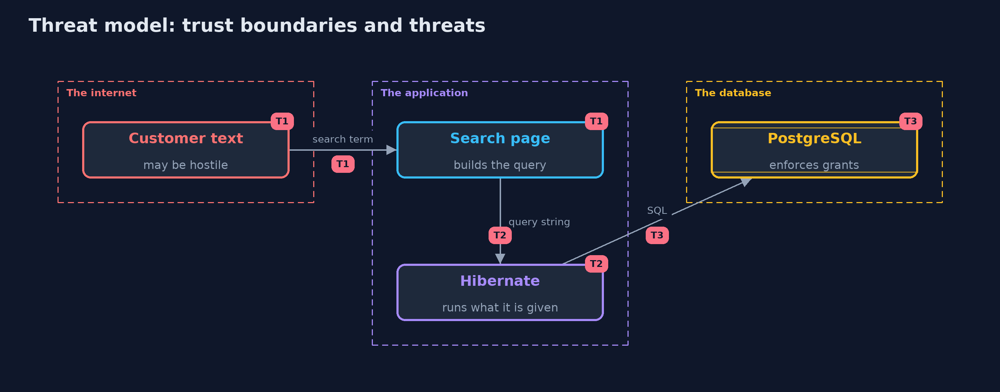

# Threat Model — SQL Injection with Hibernate and PostgreSQL

A threat model answers four questions: what are we protecting, who or what could harm it, how, and what do we do about it. This one covers this project's own demo system, not a production deployment. Domain: an online store's product search.

## Scope

The product search of an online store, written with Hibernate 7 against PostgreSQL 18. It covers JPQL, native SQL, Criteria queries and the database user the page connects as.
It does not cover the rest of the application, the network between the application and the database, or injection into other stores.

## What we protect (assets)

- Account emails and password hashes.
- Unlisted products.
- The product table's integrity.

## Who and what acts on the system

- A customer who types in the search box.
- A developer who adds a new query.

## Trust boundaries

A trust boundary is a line that data or a request crosses between parts that trust each other differently. Threats cluster where those lines are.

- The customer's text to the application: untrusted until bound as a parameter.
- The application to the database: only the rights of the search user.

Each dashed box is a trust boundary. A rose tag such as T1 shows where the threat of that number, in the table below, applies.

## Threats, using STRIDE

STRIDE is a checklist of six kinds of threat: **Spoofing** (S), **Tampering** (T), **Repudiation** (R), **Information disclosure** (I), **Denial of service** (D), **Elevation of privilege** (E).

| Id | Kind | Threat | Where it shows up | Control in this project | What is left |
| --- | --- | --- | --- | --- | --- |
| T1 | Tampering | Customer text becomes part of a JPQL or native query | `UnsafeSearch` | Named parameters, the Criteria API and an allow-list for sort keys | A new query written by string concatenation |
| T2 | Information disclosure | JPQL reads entities the page was never meant to show | `UnsafeSearch.jpql` | Constant query text; review of every string reaching createQuery | Dynamic queries that need a builder |
| T3 | Elevation of privilege | The application's database user can read every table | The database user | A search user with select on the product table only | Tables the search page legitimately needs to read |

## Assumptions

- The container is local and its admin password is a lab value.
- Hibernate and the PostgreSQL driver are current and unmodified.

## Out of scope

- Second-order injection and stored procedures.
- Denial of service from expensive queries.

## How the tests check this

- `SortColumnTest` needs no database and checks the sort allow-list.
- `HibernateInjectionTest` (tagged `integration`) checks each payload against the unsafe and the safe searches and the refusal for the search user.
- `DemoRunsTest` (tagged `integration`) compares the whole demo with the golden output.

## Where this model goes next

The next project in this module, cross-site-scripting, moves from the database to the browser: the same untrusted text, this time becoming script.
