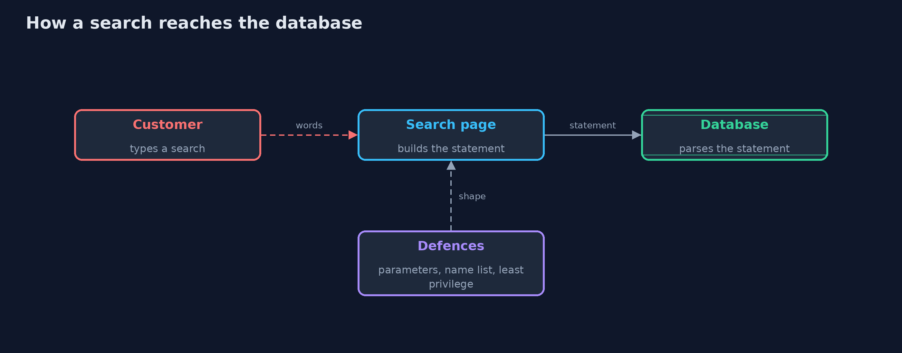
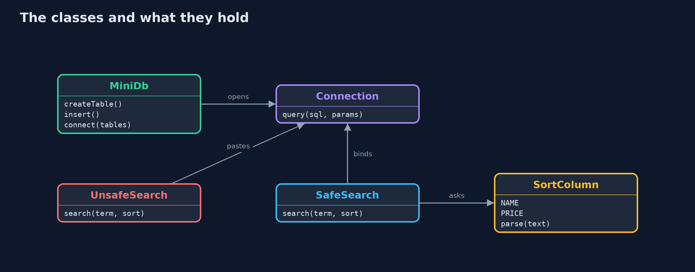
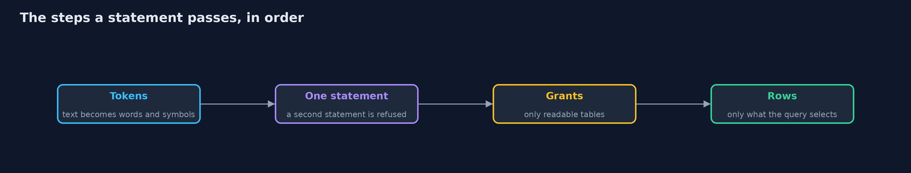
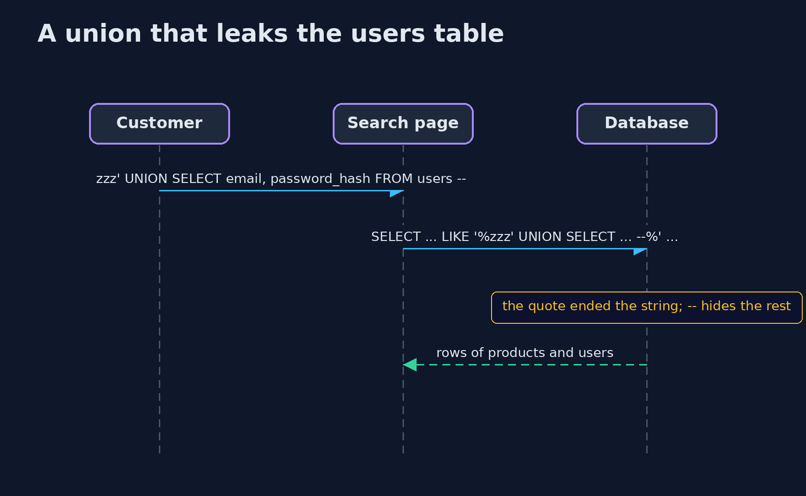

# SQL Injection and Its Defences

```
src/main/java/com/jk/explore/security/sqli/
├── MiniDb.java            A tiny SQL engine, just enough to show injection with the JDK alone
├── SafeSearch.java        The fixed search: the statement is constant text, the customer's words travel as a parameter, and the sort comes from a list
├── Shop.java              The shop's database: public products, hidden products, customer accounts and orders
├── SortColumn.java        The only columns a customer may sort by
├── SqlException.java      A statement the database refused: bad syntax, an unknown table or column, or a table the database user may not read
├── SqlInjectionDemo.java  Runs the product search story in four numbered acts and prints exact, repeatable results
└── UnsafeSearch.java      The first version of the product search: the customer's text is pasted into the statement
```

**A search box that pastes the customer's words into a SQL statement lets a quote turn those words into commands, so the statement must be fixed text, the words must travel as parameters, names must come from a list, and the database user must be able to do very little.**

A database reads a statement as one piece of text and splits it into words and symbols before it acts. If a program builds that text by pasting a
customer's input into it, a single quote closes the string the program opened, and everything after it is read as **SQL code**, not as the customer's words.
That is **SQL injection**: the customer is no longer searching, but writing part of the program.

The defences, in the order this project shows them:
- **Parameters** (prepared statements): the statement is fixed text with `?` holes, and the values travel separately. A value is never parsed as SQL.
- **Allow-lists for names**: a column or table name cannot be a parameter, so a sort column is chosen from a fixed list.
- **Least privilege**: the database user for the search page can read only the product table, so a mistake elsewhere leaks little.
- **No stacked statements**: one call runs one statement.

**Maps to:** OWASP Top 10 (2025) A05 Injection · CWE-89 · OWASP ASVS 5.0, the validation and sanitization chapter (parameterized queries).

## The idea in everyday terms

Think of a waiter who writes the order on a slip for the kitchen. If the customer may dictate the slip word for word, "a soup, and also give me
the safe's key" ends up on it in the waiter's handwriting, and the kitchen obeys. With a printed form, the customer can only fill the blanks.

## The scenario

An online store has a product search with a sort option. The demo runs a small SQL engine written in plain Java, so the whole story fits the JDK alone: it
tokenizes a statement the way a real database does, supports `UNION`, `--` comments and `?` parameters, and checks which tables a database user may read.

## Run

```bash
./gradlew run
```

The demo tells the story in 4 acts, each printing exact numbers that the tests check:

| Act | What it shows |
| --- | --- |
| 1. A search that works | An honest search for kettle finds the two listed kettles. |
| 2. A quote turns text into code | A quote and a comment reveal the unlisted Prototype Toaster, a UNION leaks the e-mail addresses of customers, and a second statement is refused only by luck. |
| 3. Parameters keep text as text | With a fixed statement, a parameter and a sort list, the same attacks find nothing and the honest search still works. |
| 4. Few rights limit the damage | If the statement is still built by pasting, a search user that may read only products gets permission denied for the users table. |

## Test

```bash
./gradlew test
```

11 tests in `DemoRunsTest`, `SqlInjectionTest`. All data is fixed, so the demo prints the same text on every run.

## What the simulation got right, and what it left out

The database is a small Java SQL engine, not a real product. It has the behaviour that matters for injection: statements are split into tokens first,
`--` ends a statement, `UNION` appends rows, a `;` starts a second statement that is refused, and a database user has a list of readable tables.

## Technologies and versions

Every version below is pinned in the project's build files and was the latest stable release when the project was built.

| Technology | Version | Used for |
| --- | --- | --- |
| Java | 25 | the language and runtime; a Gradle toolchain finds or downloads the JDK |
| Gradle | 9.8.1 (wrapper) | build and run; nothing to install, the wrapper downloads it |
| org.junit.jupiter:junit-jupiter | 6.1.3, set by junit-bom | JUnit 5: the tests (tests only) |
| org.junit.platform:junit-platform-launcher | 6.1.3, set by junit-bom | JUnit platform launcher, which Gradle needs to run the tests (tests only) |

## Learning Material

| Document | What it is for |
| --- | --- |
| [Problem statement](docs/problem-statement.md) | the situation and what the project must show |
| [Prerequisites](docs/prerequisites.md) | what you need to know first |
| [SQL Injection and Its Defences, explained](docs/sql-injection-explained.md) | the acts in prose |
| [Session guide](docs/session.md) | a one-hour lesson with exercises |
| [Animated walkthrough](docs/animation.html) | the acts step by step |
| [Threat model](docs/threat-model.md) | what is protected, who could harm it, and how, using STRIDE |
| [Spec](docs/spec.md) | what this project must be true of |
| [Expected output](docs/expected-output.txt) | the golden demo output every test and every port checks against |

### The idea in one picture

Pasted text is parsed together with the program's SQL; a parameter is not.



### Where each piece sits

MiniDb runs statements; the two searches differ only in how they build them.



### How the data moves

Each step narrows what a mistake can do.



### Who calls whom, in order




## What it costs

- **Names cannot be parameters.** A sort column or table name must be checked against a list, which has to be kept in step with the schema.
- **Parameters do not fix everything.** A `LIKE` pattern still treats `%` and `_` in the customer's text as wildcards unless they are escaped.
- **Least privilege needs separate database users** and a schema that does not put everything in one place.
- **Dynamic reports are hard.** Queries built from many optional filters need a builder that adds fixed fragments and parameters, never raw text.
- **Error messages teach attackers.** Showing the database's message hands out table and column names.

## When this is too much

A fixed query with a parameter for every value is enough for most pages. Escaping quotes by hand is not a defence: it is easy to miss one case,
and the right fix is the parameter. Do not add a web application firewall as a substitute for fixing the query.

## Where you have already met this

- `PreparedStatement` and `?` placeholders in JDBC, and named parameters in `JdbcTemplate`.
- `' OR '1'='1` in every list of attack strings.
- Breach reports that begin with a search box or a login form.
- A finding titled "SQL Injection" with CWE-89.

## Where this sits

This project is in [web-security](..) and builds on [input-validation](../../secure-coding/input-validation), which showed why input is checked,
and the beginner [authentication-vs-authorization](../../../beginner/identity/authentication-vs-authorization) project.
