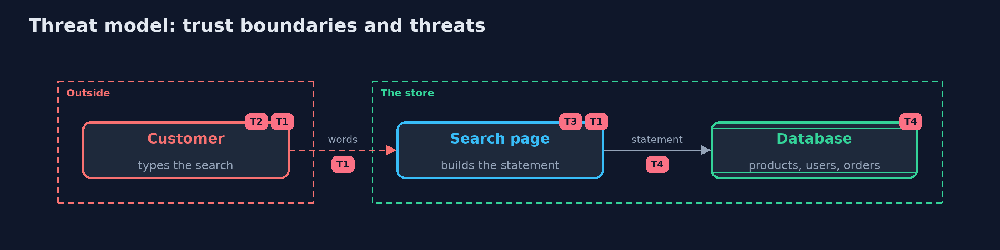

# Threat Model — SQL Injection and Its Defences

A threat model answers four questions: what are we protecting, who or what could harm it, how, and what do we do about it. This one covers this project's own demo system, not a production deployment. Domain: an online store.

## Scope

An online store's product search and sort, and the database user it runs as. It covers input that reaches a SQL statement.
It does not cover a compromised server, stolen database passwords, or injection into other interpreters.

## What we protect (assets)

- Customer accounts and password hashes.
- Unlisted products and orders.
- The products table's integrity.

## Who and what acts on the system

- An honest customer.
- An attacker who can type into the search box and the sort option.

## Trust boundaries

A trust boundary is a line that data or a request crosses between parts that trust each other differently. Threats cluster where those lines are.

- Customer to search page: all input is untrusted.
- Search page to database: the statement crosses it, and the database cannot tell the program's text from the customer's.

Each dashed box is a trust boundary. A rose tag such as T1 shows where the threat of that number, in the table below, applies.

## Threats, using STRIDE

STRIDE is a checklist of six kinds of threat: **Spoofing** (S), **Tampering** (T), **Repudiation** (R), **Information disclosure** (I), **Denial of service** (D), **Elevation of privilege** (E).

| Id | Kind | Threat | Where it shows up | Control in this project | What is left |
| --- | --- | --- | --- | --- | --- |
| T1 | Tampering | Text typed into the search changes the meaning of the statement | `UnsafeSearch.search` | A fixed statement with parameters (`SafeSearch`) | Any other place that still joins text into a statement |
| T2 | Information disclosure | A union appends the users table to the answer | `UnsafeSearch.search` | Parameters, and a search user without rights on users | A user with wider rights makes a later mistake costly |
| T3 | Tampering | The sort option carries SQL, which a parameter cannot hold | `SafeSearch`, `SortColumn` | The column is chosen from a list; anything else falls back | The list must follow the schema |
| T4 | Elevation of privilege | A vulnerable query runs with more rights than the page needs | `Shop.searchConnection` | A database user that may read only products | Rights granted later to the same user |

## Assumptions

- The driver or framework binds parameters as data.
- The database enforces the rights of its users.

## Out of scope

- Injection through ORMs: sql-injection-with-hibernate-and-postgres.
- Password storage: the beginner passwords project.

## How the tests check this

- `SqlInjectionTest` checks the three attacks, the fixed search, the sort list, the refused second statement and the least-privilege user.
- `DemoRunsTest` compares the whole demo with the golden output.

## Where this model goes next

The next project, server-side-request-forgery, moves from the database to the network: a customer makes the server fetch an address.
