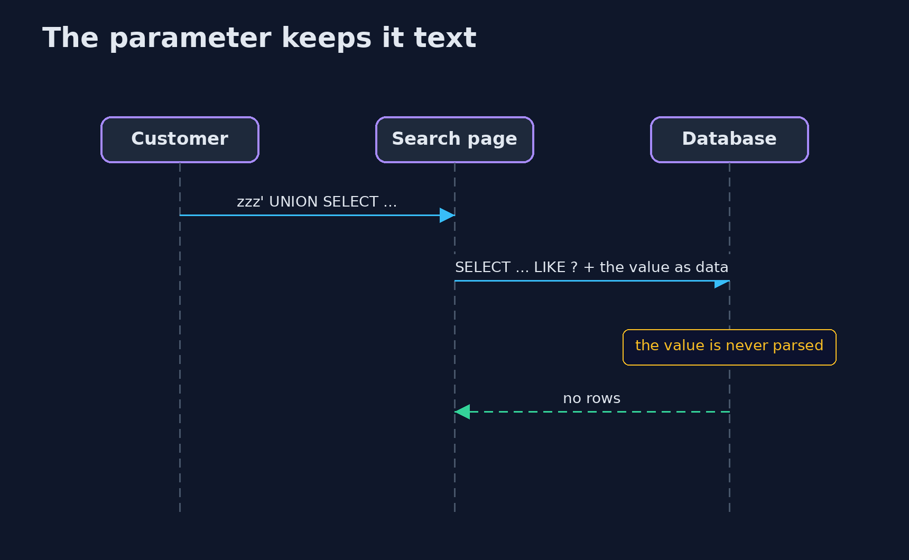
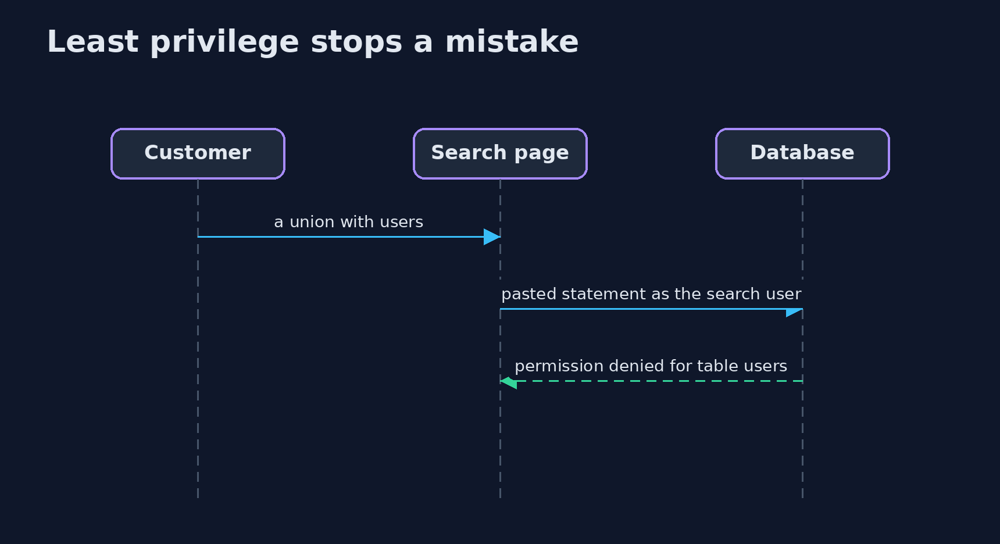

# SQL Injection and Its Defences — UML Sequence Diagrams

## 1. The parameter keeps it text

The statement and the value are sent separately.

## 2. Least privilege stops a mistake

The search user cannot read users, even if the query is vulnerable.

