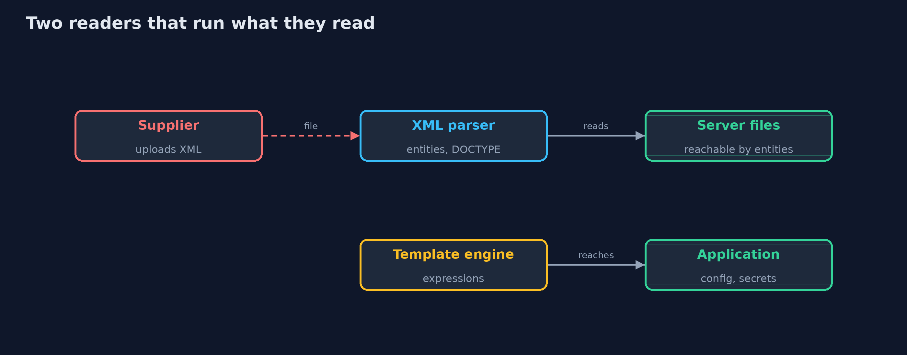
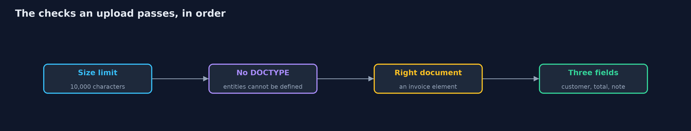
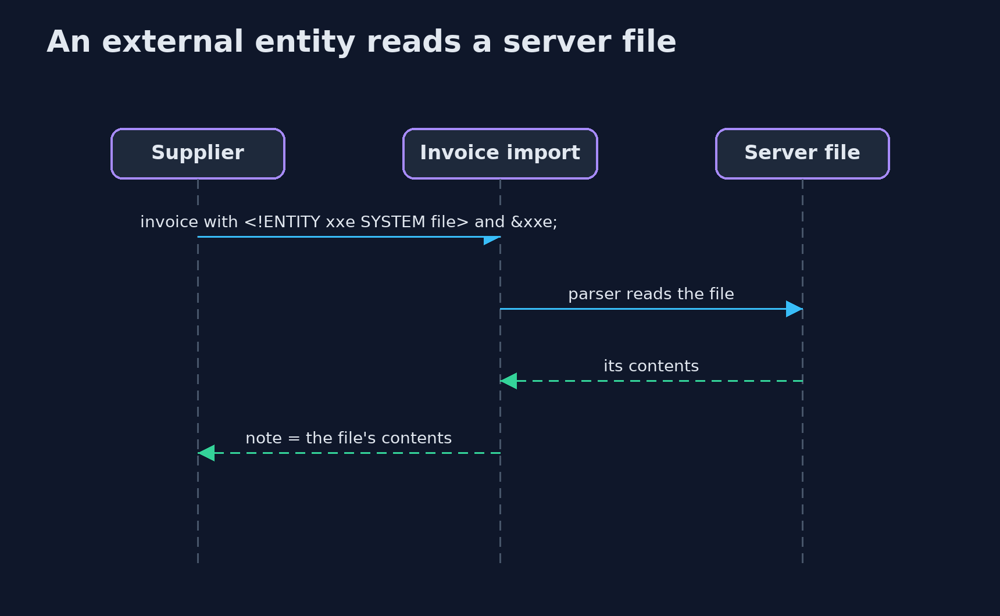

# XML External Entities and Template Injection

```
src/main/java/com/jk/explore/security/xmlinj/
├── App.java                 The running application, which a careless template engine leaves reachable from every template
├── AppConfig.java           The application's own settings: what no customer should ever read
├── Customer.java            The customer an e-mail is about
├── ExpressionEngine.java    The first version of the e-mail template engine: {@code ${customer.name}} walks object properties by reflection
├── Invoice.java             An invoice uploaded by a supplier as XML: who, how much, and a free-text note
├── InvoiceException.java    The upload was refused or could not be read
├── InvoiceParser.java       Reads {@code <invoice><customer/><total/><note/></invoice>}
├── LogicLessEngine.java     The fixed engine: {@code {{name}}} is looked up in a flat map of the few values a template may use, and the value is HTML-escaped
├── NaiveInvoiceParser.java  The first version: the JDK's parser as it comes, which reads a DOCTYPE and fetches external entities for whoever uploaded the file
├── SafeInvoiceParser.java   The fixed version: an invoice has no use for a DOCTYPE, so the parser refuses one
├── TemplateEngine.java      Turns a template and some data into an e-mail body
└── XmlTemplateDemo.java     Runs the invoice upload and e-mail template story in five numbered acts and prints exact, repeatable results
```

**An XML parser and a template engine both run instructions found in their input, so an invoice upload can read the server's files and a customer's name can run inside an e-mail template, unless the parser refuses a DOCTYPE and the engine has no expressions.**

Two features of a store look like plain data handling: an **invoice upload** in XML and an **e-mail template** with the customer's name in it. Both are read by
software that runs instructions it finds. An XML file may begin with a **DOCTYPE** that defines an *external entity*, a name whose value is fetched from a file or an address
on the **server**: that is **XML external entity injection (XXE)**. A template engine that evaluates expressions runs whatever the template says: when the customer's text
becomes part of the template, that is **server-side template injection (SSTI)**.

The defences, in the order this project shows them:
- **Refuse the DOCTYPE** in documents that have no use for one, and switch off external DTDs, schemas, XInclude and entity expansion as extra layers.
- **Limit the size** of an upload before parsing it.
- **Logic-less templates:** only named, escaped values; no expressions, no reflection, one pass over the template.
- **Never build a template from customer text.** Pass it in as data.

**Maps to:** OWASP Top 10 (2025) A05 Injection and A02 Security Misconfiguration · CWE-611 · CWE-1336 · OWASP ASVS 5.0, the validation and encoding chapters.

## The idea in everyday terms

Think of an assistant who types up whatever a letter says to do. A letter that says "enclose a copy of the file in the top drawer" gets the file enclosed, and a form letter
whose blanks are filled by the customer can be made to say "and read out the safe's code". The fix is an assistant who types up the letter and does not follow it, and a form that has
blanks only for names.

## The scenario

An online store accepts supplier invoices as XML and sends customers e-mails from templates. The demo uses the JDK's real XML parser against a temporary file that stands for a
server file, and a small template engine written for the purpose. All secrets are harmless markers.

## Run

```bash
./gradlew run
```

The demo tells the story in 5 acts, each printing exact numbers that the tests check:

| Act | What it shows |
| --- | --- |
| 1. An invoice upload | An honest invoice is read: Ana, 42.50, and a note with an ampersand. |
| 2. The parser reads what the file tells it to | An external entity makes the parser put a server file into the note; an entity bomb is stopped only by the JDK's expansion limit. |
| 3. Refuse the DOCTYPE | The safe parser accepts the honest invoice and refuses both the external entity and the bomb because they need a DOCTYPE. |
| 4. A template engine that evaluates expressions | A name pasted into the template reads the SMTP password and the customer's class name; the same name passed as data stays text. |
| 5. A logic-less engine keeps data as data | With named, escaped values and no expressions, pasted text stays text and markup is escaped. |

## Test

```bash
./gradlew test
```

10 tests in `DemoRunsTest`, `XmlTemplateTest`. The temporary file's name is random and never printed, so the demo prints the same text on every run.

## What the simulation got right, and what it left out

The XML parser is the JDK's own, so the XXE result is real: the file the entity names is a temporary file the demo writes and deletes, and its name is never printed.
The template engines are small classes in this project; one evaluates `${a.b.c}` by reflection, as some real engines do, and one does not.

## Technologies and versions

Every version below is pinned in the project's build files and was the latest stable release when the project was built.

| Technology | Version | Used for |
| --- | --- | --- |
| Java | 25 | the language and runtime; a Gradle toolchain finds or downloads the JDK |
| Gradle | 9.8.1 (wrapper) | build and run; nothing to install, the wrapper downloads it |
| org.junit.jupiter:junit-jupiter | 6.1.3, set by junit-bom | JUnit 5: the tests (tests only) |
| org.junit.platform:junit-platform-launcher | 6.1.3, set by junit-bom | JUnit platform launcher, which Gradle needs to run the tests (tests only) |

## Learning Material

| Document | What it is for |
| --- | --- |
| [Problem statement](docs/problem-statement.md) | the situation and what the project must show |
| [Prerequisites](docs/prerequisites.md) | what you need to know first |
| [XML External Entities and Template Injection, explained](docs/xml-and-template-injection-explained.md) | the acts in prose |
| [Session guide](docs/session.md) | a one-hour lesson with exercises |
| [Animated walkthrough](docs/animation.html) | the acts step by step |
| [Threat model](docs/threat-model.md) | what is protected, who could harm it, and how, using STRIDE |
| [Spec](docs/spec.md) | what this project must be true of |
| [Expected output](docs/expected-output.txt) | the golden demo output every test and every port checks against |

### The idea in one picture

The file and the template are both input to software that follows instructions in them.



### Where each piece sits

Two parsers and two engines, each pair differing in what they are willing to run.


### How the data moves

The DOCTYPE refusal comes before any entity is looked at.



### Who calls whom, in order




## What it costs

- **Some XML really needs a DOCTYPE.** Document formats such as XHTML or old SOAP services do; they need a parser configured with entity resolution that is limited by hand.
- **Parser settings differ between libraries,** and defaults change between versions. The safe settings must be written down and tested for every parser the project uses.
- **Logic-less templates are less convenient.** Loops and formatting move into code that prepares the data.
- **Escaping depends on the place** where the value ends up (HTML text, an attribute, a URL), and the right escaper must be chosen for each.
- **Template authors are trusted people.** If customers must write templates, run them in a sandbox with no access to objects at all.

## When this is too much

If the invoice can be JSON, use JSON: it has no entities. If the e-mail text never changes, use a plain text file with named holes.
Do not write a filter for the string `<!ENTITY`; there are many ways to spell it, and refusing the DOCTYPE in the parser settles the question.

## Where you have already met this

- `DocumentBuilderFactory`, `SAXParserFactory` and `XMLInputFactory` in every Java XML import.
- `<!DOCTYPE foo [ <!ENTITY xxe SYSTEM "file:///etc/passwd"> ]>` in every list of attack strings.
- `${7*7}` and `{{7*7}}` as the first probe in a template injection test.
- A finding titled "XML External Entity" with CWE-611 or "Server-Side Template Injection" with CWE-1336.

## Where this sits

This project is in [web-security](..) and follows [server-side-request-forgery](../server-side-request-forgery): an external entity can also fetch an address,
so XXE is one more way to make the server send a request.
