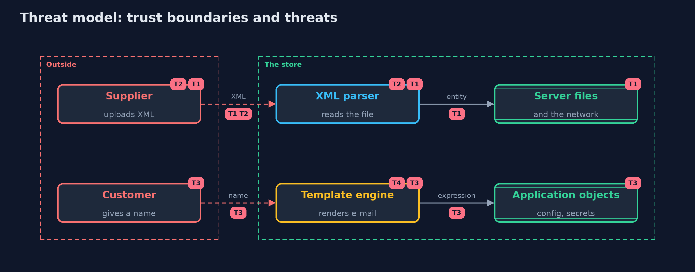

# Threat Model — XML External Entities and Template Injection

A threat model answers four questions: what are we protecting, who or what could harm it, how, and what do we do about it. This one covers this project's own demo system, not a production deployment. Domain: an online store.

## Scope

An online store's XML invoice upload and its e-mail templates. It covers the parser's configuration, the template engine and how customer text reaches them.
It does not cover other file types, XML signatures, or who may write the owner's templates.

## What we protect (assets)

- Files on the server, and what the server can reach on the network.
- The application's configuration and secrets.
- The availability of the import and the mail service.

## Who and what acts on the system

- A supplier who uploads invoices.
- A customer whose name appears in e-mails.
- The shop owner who writes the templates.

## Trust boundaries

A trust boundary is a line that data or a request crosses between parts that trust each other differently. Threats cluster where those lines are.

- Upload to parser: the file is untrusted, and the parser follows what it says.
- Customer text to template: text becomes code if it is pasted in.

Each dashed box is a trust boundary. A rose tag such as T1 shows where the threat of that number, in the table below, applies.

## Threats, using STRIDE

STRIDE is a checklist of six kinds of threat: **Spoofing** (S), **Tampering** (T), **Repudiation** (R), **Information disclosure** (I), **Denial of service** (D), **Elevation of privilege** (E).

| Id | Kind | Threat | Where it shows up | Control in this project | What is left |
| --- | --- | --- | --- | --- | --- |
| T1 | Information disclosure | An external entity reads a server file or fetches an address | `NaiveInvoiceParser` | `disallow-doctype-decl`, no external DTD or schema access | Another parser in the project with default settings |
| T2 | Denial of service | An entity bomb exhausts memory and time | `NaiveInvoiceParser` | No DOCTYPE, secure processing and a size limit | Very large documents that are within the size limit are still parsed in memory |
| T3 | Elevation of privilege | Customer text pasted into a template runs and reads the application's objects | `ExpressionEngine` | A logic-less engine, and customer text passed as data | A developer who builds templates from input for another engine |
| T4 | Tampering | Markup in a value changes the HTML of the e-mail | `LogicLessEngine` | Values are escaped for HTML text | A value placed in an attribute or URL needs the escaper for that place |

## Assumptions

- The XML parser honours its configuration, and the same configuration is used for every upload.
- Templates are written by the owner and kept as fixed files.

## Out of scope

- XML signature wrapping: saml-basics.
- Cross-site scripting in the e-mail's HTML: the cross-site-scripting project.

## How the tests check this

- `XmlTemplateTest` checks both parsers and both engines, including temporary files for the entity, the bomb, size limits and escaping.
- `DemoRunsTest` compares the whole demo with the golden output.

## Where this model goes next

The next project, insecure-deserialization, moves to objects that a server rebuilds from bytes a customer sends.
