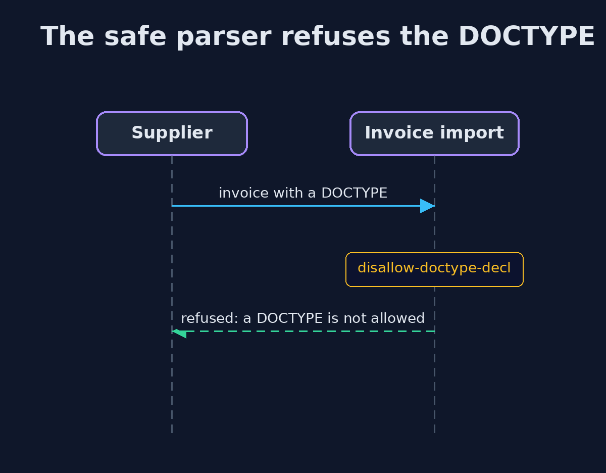
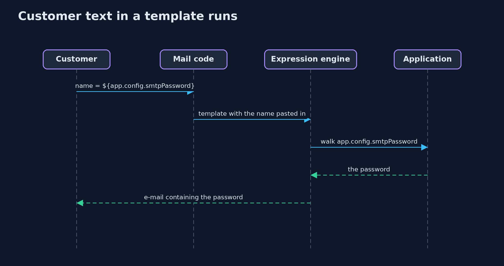

# XML External Entities and Template Injection — UML Sequence Diagrams

## 1. The safe parser refuses the DOCTYPE

## 2. Customer text in a template runs

The name was pasted into the template, so the engine evaluated it.

